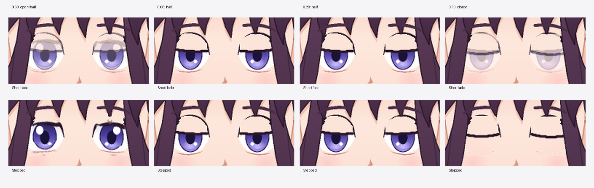

# Experimental eye transitions: real visual comparison

**Status:** opt-in mitigation, not a production-quality blink solution.
**Sample:** locally imported, MIT-licensed RevStudio/Rev2D Hana art (see [third-party notices](THIRD_PARTY_NOTICES.md)).
**Date:** 2026-11-07.

## Why a shorter fade still ghosted

The imported Rev2D eye rig has an open mesh plus separately drawn half-closed and fully closed sprites. The earlier short-fade experiment still made two complete, **misaligned eye drawings simultaneously translucent**:

- Closed → half at `EyeOpen=0.18–0.20`.
- Half → open mesh at `EyeOpen=0.68–0.70`.

Blending two different lash geometries yields duplicate contours, see-through eyes and pale iris fragments. Narrowing the fade merely shortens the duration of this artifact.

## Opt-in stepped-eye profile

`--experimental-stepped-eyes` replaces just those opacity controls with near-instant, complementary visibility switches:

| EyeOpen parameter | Visible eye appearance |
|---|---|
| Below 0.195 | Closed drawing |
| 0.195 to below 0.69 | Half-closed drawing |
| At/above 0.69 | Original open mesh |

A tiny `0.0001`-wide ramp is used instead of duplicate key coordinates because Rev2D requires well-defined interpolation keys. All other rig parameters, meshes, textures, expressions and mouth controls remain unchanged. The transformer accepts only the previously validated Rev2D two-eye sprite topology; unfamiliar rig bindings are rejected.

**This stops the sampled double-image opacity problem, but it is *not smooth geometry morphing*.** The entire eye appearance can pop at either switch. Use only when that tradeoff actually looks better for the character and intended blink speed.

To use it with **reviewed, user-provided** full-canvas half/closed drawings:

~~~powershell
node dist/cli/index.js character variants import avatars/portrait eyes_closed eyes_half --experimental-stepped-eyes --reviewed-art
node dist/cli/index.js character qa blink avatars/portrait
~~~

Only one experimental profile is permitted; `--experimental-short-fade` and `--experimental-stepped-eyes` cannot be combined. The import revokes prior character approval, rebuilds the review images and refreshes provenance hashes. The program never grants approval or claims that a character has been visually reviewed.

## Observed comparison

*Source: actual Rev2D rendered pixels at identical `EyeOpen` values and identical source illustration. Top row: short fade. Bottom row: stepped. The original Hana asset is MIT-licensed (RevStudio).*

In the local test the unapproved experimental Hana character's **translucent double lashes at 0.69** and **ghosted irises at 0.19** were absent in the matched stepped renders. The prior half-open and closed drawings still have a visibly stiff, imperfect outline.

The same 25-frame, 13-real-render plus mirrored opening review sequence gave:

| Pixel QA diagnostic | Short fade | Stepped |
|---|---:|---:|
| Possible abrupt changes | 0 | 4 |
| Possible changed-control motion stalls | 10 | 12 |

The stepped profile deliberately creates jumps; the automated warning is expected and **should not be suppressed or relabeled as an artistic pass**. The stalled intervals reflect static sprite holds (some intentional). Neither diagnostic alone assesses visual acceptability.

A separate **mesh-only** experiment—no replacement eye sprites, continuously deforming the original mesh—had fewer opacity artifacts, but noticeably squeezed/distorted the eyelids and irises near full closure. That was not selected.

The full locally ignored A/B sequence video is:

`outputs/qa/eye-profile-comparison-20261107/ordered-blink-comparison.mp4`

This is a **non-uniform parameter-sweep review clip** (25 frames at 30 FPS), **not** a natural-timing performance demo.

A separate disposable, **QA-only** copy of the stepped actor was temporarily marked approved solely for renderer integration testing. It exported a valid 3-second, 15 FPS, 512×640, 45-frame H.264 MP4 via the verified-rig snapshot path. That marker was never applied to the experimental source character. The source remains `approved:false`.

## Acceptance boundary and next work

Actual quality requires better curved, consistent eye artwork and/or a continuous eyelid-specific mesh with properly hidden irises. A reversible stepped visibility option is useful for stylized quick blinks, but shouldn't become a default or be described as Live2D-grade deformation.

Do **not** approve this Hana trial, infer quality from geometry checks, or publish copied test art without preserving the MIT notice. Before approval, inspect the entire blink video, seam/iris/color consistency, gaze extremes, head movement and the surrounding face at target FPS. Compare at least two additional rights-cleared illustration styles.
