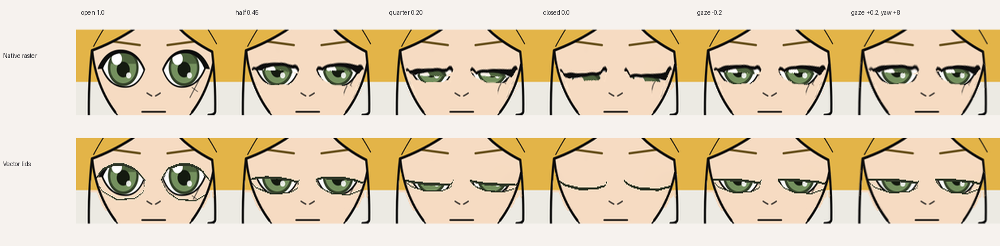

# Second illustration and combined-expression eye QA (2026-11-08)

**Status:** second-style integration **PASS**; subjective character-quality approval **FAIL / NOT APPROVED**. Do not turn this into a generic one-click importer claim.

## Independent licensed artwork

The second illustration is **Satoko**, an original code-drawn chibi character from Henrik Hanssen's [anime-character-creator](https://github.com/rhedak/anime-character-creator), MIT-licensed, at pinned commit `8a52cd146445b1aee4d890df5e44bcf9102cceef`. This differs substantially from RevStudio's Hana: simple vector strokes, flat-colored hair, large green irises, tiny nose and mouth, full body and a short stylized face. It is not a recolor or re-render of Hana. The original PNG checkout and all generated model files remain under ignored `.cache/`; this repository includes only a small attributed **derived comparison crop**.

The source `ref-out/satoko.png` (800×1000) was locally resized to 512×640 and imported without network processing. Coordinates were placed manually from the source-pixel grid and inspected on a real landmark overlay. Rev2D's initial landmark validator reported **zero warnings**, then the full build reported **two nonblocking PuppetControl triage warnings**: body pivot too low and body fade starting below the chest. Neither was suppressed; they need a proper body rig correction if we ever use Satoko for a full performance.

## Actual imported vector rig

- `character import` → source/spec created, unapproved.
- `character build` → model, textures, review PNGs and SHA-256 record, unapproved.
- `character eyes vectorize --experimental` → four continuous upper/lower eyelid strips, a separate model, fresh hash record and current-model blink review package, **approved:false**.
- `character qa eye-stress` → 16 real pinned Rev2D snapshots combining eye closure, asymmetric wink, gaze left/right/up/down, head yaw/pitch, happy/confused mouth, speaking and combined head+gaze+expression. Contact sheets and a JSON manifest written to a unique ignored QA directory.
- `character eyes review` → now regenerates model-bound `blink-eyes.png`, `blink-full.png`, 36-frame 30 FPS H.264 blink and the **16-case combined-control eye sheet**. The review proof is version 2, binding all four artifacts and exact model SHA-256. Old version-1 proofs are rejected; existing vector avatars can regenerate evidence without changing their approval.

Sample contact sheets were checked visually in both Satoko and Hana. The combination cases are bounded diagnostics, not human-quality certification; static pictures do not prove motion continuity.

## Actual image comparison

The top row exhibits pointed lash tips, dark overlaps and iris trace during quarter closure. The vector bottom row reduces those artifacts and closes more cleanly. **Remaining defects:** green/gray iris residue beneath almost-closed lids, simplified or doubled fine lines at the lash boundary, and body/head deformation risks from the first landmark pass. The vector eye technique *runs* on a second independent art style, but the current output is **not good enough to automatically approve or describe as polished Live2D quality**.

The original Hana sample has cleaner near-closed geometry under vector eyelids, but its facial art also remains experimental. The difference is why independent styles matter.

## Reproducing locally

Requires a pinned Rev2D checkout and FFmpeg in PATH. Reuse an existing imported, provenance-verified, **unapproved** character rig:

~~~powershell
node dist/cli/index.js character qa eye-stress .cache/avatar-onboarding/satoko-second-20261108
node dist/cli/index.js character qa eye-stress .cache/avatar-onboarding/vector-review-proof-20261108
~~~

Each invocation creates `outputs/qa/eye-stress/<uuid>/` with `frames/frame-000.png` through `frame-015.png`, `expression-full.png`, `expression-eyes.png`, and `eye-stress.json`. No input model or approval bit is changed, and missing/limited controls are rejected. For a vector rig, `character eyes review <project>` regenerates the model-bound proof with both a neutral timed blink and expression stress case.

## Full-scene integration check

For renderer integration only, a separate **disposable copy** of Satoko was marked `approved:true` by a QA script. The original imported source project and its model-bound review package remain `approved:false`. On the QA copy, the normal `scene new` → `scene validate` → `scene render` workflow produced a real **3.000-second silent H.264 MP4 at 512×640, 30 FPS, 90 frames**, passing the project's FFprobe acceptance checker. Frames at 0, 1 and 2 seconds were also visually inspected, with the same cartoon character identity preserved. This tests software integration **only**, not approval or animation quality.

## Still blocked

- A human/artist must repair Satoko's closed-lid color/iris leakage and review gaze/face/neck. **It is not approved.**
- Both artworks still lack broad pose and full-speaking quality certification. We need a third, independently prepared character style before enabling any universal default.
- The proof verifies artifact bytes and model identity; it does **not** prove a human inspected a sheet or that it is aesthetically acceptable. Never automatically run `character approve --reviewed`.
