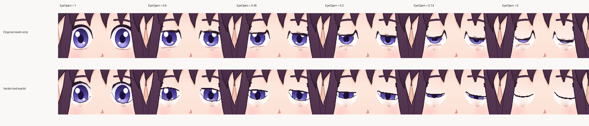

# Experimental continuous vector eyelids

**Status:** working, opt-in imported-avatar rigging experiment; artist approval **not automatic**.

A single-image Rev2D import extracts pixels around each upper/lower eyelid and bends those raster layers as the eye closes. On the imported Hana trial this created sharp triangular lashes, pinched eye corners and pale edges. Changing only the opacity fade or smoothing/capping the raster warp moved these artifacts around rather than fixing them.

## What is different

The new rig derives four small, smoothly deforming **vector ribbons** from the upper and lower rows of the *existing* Rev2D eye-white mask. Each row provides matching coordinates at `EyeOpen=1` and `EyeOpen=0`; the engine interpolates vertex positions at intermediate openings. A thin filled lash ribbon follows each curve (one upper and one lower per eye).

- The **existing iris stays clipped** by the original deformable eye-white mask.
- The old extracted upper/lower lash images and their rim layers are hidden in the derived model, not deleted.
- Existing `eyes_closed`/`eyes_half` sprite overlays are hidden and known mesh-hide bindings restored in the **derived** model. Mouth, head, brows and hair logic remain in place. Smiling-eye sprite rigs are rejected for now rather than silently changing expressions.
- The ribbon's black/brown shade comes from the imported eye-layer metadata, with independently verified left/right mapping.
- The original user images, textures and source model remain present and unchanged.

This is **genuine continuous vertex deformation within Rev2D**, not an alpha crossfade, still-image replacement, or a replacement renderer. It also simplifies lash styling, so it is unsuitable for every drawing.

## Run it on one already built imported character

~~~powershell
node dist/cli/index.js character inspect avatars/portrait/character.json
node dist/cli/index.js character eyes vectorize avatars/portrait --experimental
~~~

The command requires a single-pose, provenance-verified imported Rev2D character, a compatible eye mask and both upper/lower eye layers. It validates all vertices, closed/open keyforms, both lash colors, source hashes, and the **pinned** Rev2D backend. It refuses unsupported eye topology, malformed masks, stale assets, existing vector ribbons and smile-eye variants.

It deliberately **revokes previous approval before publishing** the new model. Its unique `*-vector-eyelids-<uuid>.r2d.json` file is validated and hashed, the manifest is updated to reference it, and the original model and original user artwork are preserved. A successful operation generates a private `outputs/qa/blink-review/<uuid>/blink-timed-30fps.mp4` plus eye/full contact sheets and motion warnings. It returns the exact paths.

### Current-model review evidence is required before approval

Old `review/poses.png`, `review/turn.png`, `review/eyes.png` and `review/mouth.png` may have been generated **before** vectorization. Their presence alone is insufficient evidence for the new eyelid rig.

The vectorize operation now writes `review/vector-eyelids-proof.json` only **after** a real timed Rev2D blink, full/eyes contact sheets, and 16 actual combined head/gaze/expression renders have completed. It copies those four artifacts to a unique `review/vector-eyes-<uuid>/` directory. The proof binds the **exact model SHA-256** from `avatar-build.json` to the SHA-256 hashes of all **four** review artifacts (full-frame blink sheet, eye blink sheet, timed MP4, and combined head/gaze/expression eye-stress sheet). This is proof format version 2; older version 1 proofs must be regenerated. `character approve --reviewed` refuses vector geometry without a matching proof, even if its model filename was manually changed.

If FFmpeg fails, review files are lost or a generated package becomes stale, rerun:

~~~powershell
node dist/cli/index.js character eyes review avatars/portrait
~~~

This regenerates only the review evidence for the current provenance-verified vector rig. It leaves the rig and its existing approval state unchanged; it never auto-approves. Inspect the newly returned full-frame and eye close-ups and the timed video **plus** the older head/turn/mouth sheets for unchanged regions before recording your own `--reviewed` acknowledgement.

A proof verifies exact bytes and which model produced the review package. It **does not** verify that a person actually looked at the images, that the images are visually acceptable, or that the model is suitable for other character styles.

The current mutation is a local, non-transactional pair of file replacements for the model reference and fingerprint record. An interrupted update can temporarily fail verification, **never implicitly approve** an avatar. Restore the previous verified project copy or explicitly rebuild with `character build ... --force` if that happens. Make a backup of your imported project before experimenting.

Do not combine the derived vector rig with subsequent drawn-eye variant imports without rebuilding the avatar first; Rev2D's upstream variant importer targets its original model filename.

## Real sample comparison (matching EyeOpen parameters)

*Both rows are actual pinned Rev2D rendered pixels from the MIT-licensed Hana illustration. No external image generation or hallucinated frame retouching. Upper row: original mesh with drawn-eye sprites disabled. Lower: experimental vector strips on the identical original eye-white mask.*

In this single test, the vector strips eliminate the sharp outward triangular lash spike at `EyeOpen=0.3/0.14` and meet along a cleaner closed curve. They do not exactly reproduce the original painted lashes, and a different style or head angle may expose seams. The line weight and tone still require artistic review.

[Watch the 30 FPS continuous vector eyelid blink](media/hana-vector-eyelids-30fps.mp4)

A disposable, unapproved imported Hana project successfully generated the model and hash record with `character eyes vectorize`. An **additional separate QA-only copy** was temporarily marked renderable to exercise the standard first-video path; its 3-second 512×640, 30 FPS, 90-frame H.264 output passed FFprobe acceptance. The real imported test source remains `approved:false`.

## Second art-style trial and combined-expression review

The same vector rig process was applied to independently imported MIT-licensed **Satoko** artwork (Henrik Hanssen, pinned source commit in [third-party notices](THIRD_PARTY_NOTICES.md)). It generated a valid separate model, a 36-frame timed blink, 16 combined head/gaze/mouth/eye renders and a 90-frame full-scene integration video on a disposable QA-only renderable copy. **Visual approval still failed:** Satoko has a thin green/gray near-closed iris trace and simplified lash lines. Compare [matched states](media/satoko-vector-eye-comparison.png) and read [the full second-style report](SECOND_STYLE_EYE_QA.md).

The optional `character qa eye-stress <project>` command exports a **4×4 / 16-case** full-face and eye-crop sheet and a JSON report of the exact parameter combinations. The model-bound review proof now requires the stress-eye sheet along with the two neutral blink sheets and timed MP4. This is additional evidence, not an automated beauty/quality threshold.

## Remaining gates

1. Inspect frame-by-frame eyelid curves at 0, 0.1, 0.25, 0.5, 0.75, 1, plus head turns and iris extremes. No metric certifies the art.
2. Review on at least two more independent, rights-cleared styles before considering vector eyelids a broadly suitable default.
3. Add artist-configurable upper/lower lash widths, smooth corners and optional hand-authored details. The test uses fixed widths (upper 2.8 px, lower 1.2 px) and source-derived RGB.
4. Test real natural-speaking videos and eye expressions. This only changes the eyelid line; head/neck/pose transition and lip-sync quality remain separate issues.

**Always use `character approve <project> --reviewed` only after a person has inspected the actual updated rig's generated frames and its original artwork.** The CLI does not approve anything here.
